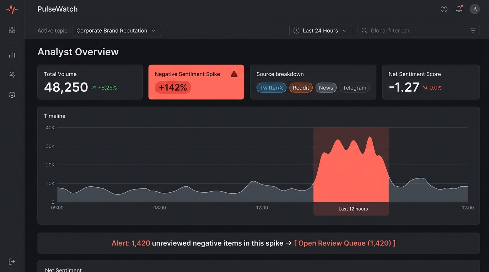
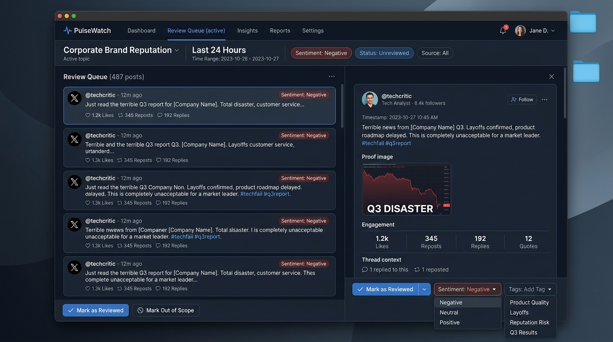

# PulseWatch — Social Media Intelligence & Analytics Platform

Desktop UX/UI redesign for high-volume communications analysis and social listening.

---

## 📸 Designed Screens

### Screen 1: Analyst Overview (Spike Detection)
The initial shift dashboard showing the active topic, time range, key metrics, and an alarming surge in negative mentions.

---

### Screen 2: Review Queue (Reading & Tagging Workspace)
Split-view master-detail interface carrying over the exact same filters from the Overview.

---

## 📝 Design Rationale Note (148 words)

> **Core Layout Architecture & Interaction Philosophy:**
> 
> The redesign solves the disjointed experience of legacy social listening tools by creating a unified **"Detect-to-Action"** loop between two tightly coupled desktop workspaces.
> 
> On the **Overview screen**, a calm, dark-themed dashboard keeps cognitive load low until an anomaly occurs. A prominent visual spike in negative sentiment immediately highlights critical brand events, paired with a direct CTA banner carrying active filters (*Topic: Corporate Brand Reputation*, *Range: Last 24 Hours*, *Status: Unreviewed*) into the work queue.
> 
> The **Review Queue screen** adopts a high-density, split-view Master-Detail layout. The left pane enables rapid scanning of incoming volume with clear metadata badges. The right pane keeps the active post open in-place with its full thread, proof images, and rapid-action controls (`Mark as Reviewed`, `Out of Scope`, and sentiment/emotion tag adjustment). Analysts never lose their place, ensuring seamless high-volume shift throughput.

---

### Key Features:
- **Shared Filter State:** Persistent context between detection and review.
- **RTL & LTR Ready:** Flexible spacing for localization and multiple languages.
- **Focus on Proof:** Media and links preserved inside the item inspection panel.
